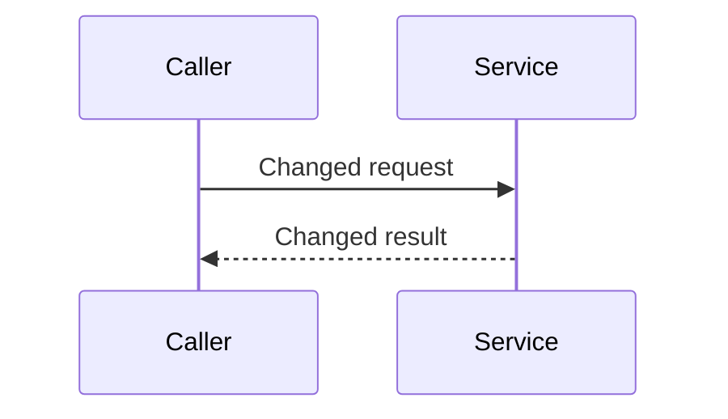

# GitLab Merge Requests and Pipelines

Derive `PAYMENT_PLUGIN_ROOT` from this procedure's installed path (the directory containing
`plugin.json`) before running bundled commands; do not assume a host-provided plugin-root variable.

Read [workflow-policy](../workflow-policy.md) for guided recovery, check classification and
risk-selected review. This procedure does not broaden the calling task's authority.

## Authority

Within an authorized L3 run: push its selected feature branch, create/update its draft MR,
read MR state/logs and perform bounded non-deploy pipeline repair. Reading an existing MR
requires no mutation authority. Do not post comments unless the user requests them.
The parent Run performs SNS tracking through the bundled
[`sns-l3-labelling`](../sns-l3-labelling/PROCEDURE.md) at final handoff. Do not invoke it during
MR creation or nested review; keep existing `l3-workflow` labels and engineering status intact.

Human approval required, every time: marking an MR ready, approving, merging, touching another
person's MR, triggering a deploy pipeline, creating tags or releases, changing CI configuration.

## Never call these

`glab ci view`, `glab ci view <id>` and `glab ci trace` require a TTY and fail here with
`ERROR: Ci view requires an interactive terminal (TTY)`. Use the API forms below instead.

## Preflight

```bash
python3 "${PAYMENT_PLUGIN_ROOT}/scripts/doctor.py" --group core,gitlab
```

Both `glab` and `gitlab_client.py` read `GITLAB_PRIVATE_TOKEN` from the environment themselves.
Never extract the token into a shell variable, never pass it as an argument, and never write a
`curl` with a `PRIVATE-TOKEN` header — that puts the credential in shell history and in the agent
transcript. Do not `source ~/.zshrc` either; it emits `compdef:153` errors under bash.

If a call fails with 401, confirm the variable is present without printing it:

```bash
python3 "${PAYMENT_PLUGIN_ROOT}/scripts/doctor.py" --group gitlab
```

## Merge requests

| Intent | Command |
|--------|---------|
| Push branch | `git push -u origin "$(git rev-parse --abbrev-ref HEAD)"` |
| Open L3 draft MR | `glab mr create --draft --yes --label l3-workflow --title "<repository-compliant-title>" --description "<body>"` |
| List | `glab mr list` |
| View | `glab mr view <iid>` |
| Diff | `glab mr diff <iid>` |
| Comment | `glab mr note -m "<message>" <iid>` |
| Checkout | `glab mr checkout <iid>` |

Stop and ask before: `glab mr merge`, `glab mr approve`, `glab mr update --ready`.

The MR title is also the default squash commit subject. Obtain the repository-policy-validated
title from `git-commit`; never use `--fill` for an L3 MR. GitLab may return a draft title as
`Draft: <squash subject>`; strip only that UI prefix for validation and never remove it by marking
the MR ready. In repositories with the GXS Jira-key policy, require the canonical subject to match:

```regex
^(feat|fix|docs|style|refactor|perf|test|chore): \[[A-Z]+-[0-9]+\] .+$
```

In Local Markdown mode, never invent a Jira key to satisfy this example. Follow the target
repository's documented title policy and include `work_item.id` when that policy permits it. If the
target repository mandates a Jira key, the missing key is a repository delivery constraint: stop
before push and report it rather than rejecting L3 admission or fabricating an issue. Any title that
violates the actual repository policy blocks handoff even when the branch pipeline is green.

## Pipelines

```bash
glab ci status                                    # snapshot, TTY-safe
glab ci view --web                                # opens browser, non-blocking
```

List jobs without a TTY:

```bash
glab api "projects/<url-encoded-path>/pipelines/<pipeline-id>/jobs" \
  | python3 -c "import sys,json;[print(f\"{j['name']:45} {j['status']:10} {j['stage']}\") for j in json.load(sys.stdin)]"
```

Read a failing job's log:

```bash
glab api "projects/<url-encoded-path>/jobs/<job-id>/trace"
```

Derive `<url-encoded-path>` from the canonical project path of the validated target remote, or use
the canonical GitLab numeric project ID. Never copy a project path from the plugin's source repository
when delivering a different target.

## Self-healing a failing pipeline

1. List jobs, identify every job with status `failed`.
2. Read each failing job's trace; extract the first real error, not the final summary line.
3. Reproduce locally with the equivalent command from `repo-context` before changing anything.
4. Classify the repair before acting:
   - no-code infrastructure retry on the same SHA: retry; existing review remains valid;
   - code-changing repair: fix locally, refresh affected verification and obtain current-candidate
     full/delta independent readback under the selected risk roster; do not replay unrelated phases;
   - unavailable local tool: use equivalent required CI only if repository policy permits, with
     verification-pending until the actual check passes;
   - unrelated prerequisite defect: report evidence and propose separately authorized work.
5. For a code-changing repair, push the newly reviewed SHA, record the remote/MR SHA and pending
   pipeline in the machine-local review manifest, and update the human MR description only when
   behavior, rationale, risk, verification, or a known limitation changed.
6. Wait for the actual required parent/child jobs for that candidate. A skipped or unrelated green
   job is not evidence. When all required jobs pass, read the final pipeline SHA and status from
   the GitLab API and store them in the machine-local review manifest. Do not copy pipeline IDs or
   internal review identities into the MR description.
7. Verify the remote branch SHA, MR SHA, and successful pipeline SHA all match the reviewed local
   `HEAD`.
8. After three failed attempts or repeated no progress, preserve the MR/worktree and report the
   failed or pending check plus next action. Resume affected work after resolution.

Never disable, skip or `allow_failure` a job to make a pipeline green. That is a control change
and needs a human.

Before L3 handoff, read the MR back. Apply/read back `l3-workflow` when supported and authorized;
labeling failure is advisory. Prove current local candidate, remote source branch and MR match,
each selected independent review covers that same candidate/tree/full diff, and every required
CI job evaluated it successfully. Keep the risk roster, review scope and exact response/check
artifacts in the machine-local review manifest. An adopted-candidate review must not imply prior
full-lifecycle specification/plan approval.

When a required local check is unavailable, available checks and independent review must pass
before a repository-policy-permitted draft push to obtain equivalent CI evidence. Report
verification-pending until the actual required job passes. A failed required test/security check
or secret hit cannot use this exception. A successful pipeline for an older SHA is stale evidence,
not a green delivery.

## MR description

Write a short `Description of Change` explaining what changed and why. Read and apply the
bundled sibling [`unslop`](../unslop/PROCEDURE.md) procedure to the final description and handoff.
Include a Mermaid `sequenceDiagram` under that heading whenever the changed interaction can be
shown meaningfully. Use actual participants, calls, and ordering from the current diff; omit the
diagram for changes with no meaningful interaction to show. Use another diagram type only when
it explains the changed behavior more clearly.

Do not add unit-test inventories, numbered TC lists, commands/results, coverage or CI narration,
manual/non-production validation inventories, or `N/A` / `not performed` boilerplate. Omit
`Test Evidence`, `Test Cases`, `Testing Procedure`, `Validation performed`, generic checklists,
and empty `Additional Notes` sections. Keep verification evidence in machine-local artifacts
and report meaningful results in the chat handoff. This changes presentation only: all required
checks, independent review and CI verification still apply. If a behavior constraint is necessary
to understand the change, fold it into the short change explanation in one sentence.

Do not add `Checklist`, `Risks and limitations`, deployment or rollback sections, or move their
report-style detail under another heading. Omit approval boxes, compatibility/rollback verdicts,
deploy-order narration, unused-field commentary, unchanged consumer behavior and logging/test
gaps. Put actionable coordination and verification gaps in the chat handoff. The bundled shape
also applies when a global GitLab skill or optional repository template offers a longer template;
do not import that boilerplate. Required engineering checks still apply.

Never publish L3 source snapshots, internal hashes, review identities, persona verdict tables,
finding counts, bounded L3 verdicts, or pipeline IDs in the MR description or comments. Keep them
in the machine-local review manifest. A Jira or committed-plan link is allowed when useful.
Read the description and diagram back against the final diff. Separately use the GitLab API to
verify remote branch, MR, and pipeline identities against the manifest.

Before every create/update, pipe the exact final description to the bundled
`scripts/validate_mr_description.py` from the plugin root. Fix reported boilerplate before
publishing; check the final body again after any rewrite. This shared check works in every
harness; it is not an OMP hook or a replacement for reading the prose against the diff. See the
description reference for narrow exceptions when a field is explicitly required or unchanged
human-authored content must be preserved. Writes through other tools are not automatically blocked.

Full guidance and a worked example: `references/mr-description.md`.

Honor explicitly required target-repository fields, but do not copy optional test/checklist
boilerplate from templates. Do not append the old house template. Default shape:

````markdown
## Description of Change
<short explanation of what changed and why>


````

The participants above are placeholders for the shape only; replace them with verified names
and interactions, or omit the diagram when it would invent a flow. Include extra sections only
when the user explicitly requests them or target-repository policy requires them. Before publishing,
remove excluded sections and report-style detail from agent-written prose; preserve unrelated
human-authored content in an existing MR.

Never place credentials, customer data, production logs or internal endpoints in an MR
description, comment or commit message.

## Docker tags and release artifacts

The bundled image-tag lookup (`gitlab_client.py find-tag`) and SHIPRM release regression
evaluation (`regression_test.py`) are conditional compatibility tools for supported Dakota
Payment/SHIPRM services only: `references/artifacts.md`. For every other target, follow the target
repository's documented artifact or CI contract, or record `N/A` when no release artifact applies.
Never fall back to the payment registry for an unrelated repository. Reading and reporting results
is unattended; acting on them — promoting, merging, redeploying — is not.

## Failure handling

| Symptom | Action |
|---------|--------|
| `glab` missing | repair the known executable path or use an authorized same-source equivalent; otherwise preserve work and report delivery pending |
| auth failure | diagnose selected account/site access without exposing secrets; never change credentials or bypass denied permission through another client |
| branch not pushed | `git push -u origin "$(git rev-parse --abbrev-ref HEAD)"` |
| merge blocked | report the blocker and stop; do not attempt to clear it |
| tag not found | For a supported Dakota Payment/SHIPRM service, report that the expected push job or tag is absent and do not retrigger; for any other target, use its repository-defined artifact contract or record `N/A`, never the payment registry |
