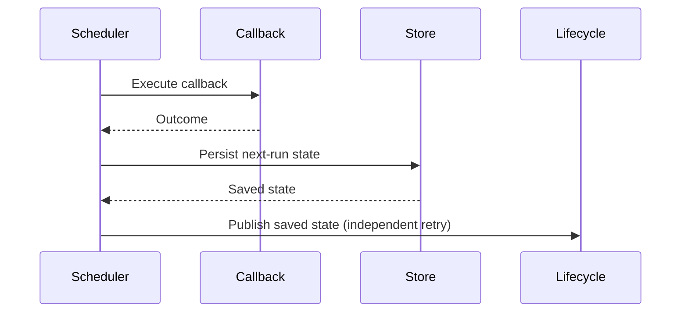

# Writing an MR Description

Loaded by `gitlab-mr` when opening or updating a merge request.

## Default shape

Use `## Description of Change`, a short explanation of the changed behavior and its purpose,
and a Mermaid sequence diagram when possible. Name the affected behavior directly. Scale the
length to the change; a small fix may need only one or two sentences.

Prefer `sequenceDiagram` for a meaningful interaction between components or workflow steps.
Show the real participants, changed calls, responses and ordering under `Description of Change`.
Use `alt` / `else` only for relevant changed paths. A flowchart or state diagram is appropriate
when it explains the change more clearly. Omit diagrams for wording or configuration changes
with no meaningful interaction to show; never invent a runtime flow to fill the template.

### Example

````markdown
## Description of Change

Publish the persisted next-run state after the callback finishes. Retry publication separately
so a publishing failure does not execute the callback again.


````

The example is illustrative. Every real description and diagram must match the current diff.
Use verified service, operation and state names. Show only the interaction changed by the MR.
Explain only what the change does and why. If a behavior constraint is necessary to understand
the change, fold it into that explanation in one sentence. Put operational coordination and
verification caveats in the chat handoff; do not expand them into an MR report.

## Keep boilerplate and reports out

The bundled shape is the default for Shipmate, including when a global GitLab skill, repository
template or previous MR offers a longer optional template. Do not import its checklist or append
sections to make the description look complete. Explicit user instructions and mandatory
repository fields still take precedence; an available template alone is not a requirement.

Do not add `Checklist`, `Risks and limitations`, `Deployment`, `Rollback`, `Verification` or
`Testing` sections. Do not replace them with renamed sections or append the same report under
`Description of Change`. Omit approval boxes, compatibility/rollback verdicts, deploy-order
narration, unused-field commentary, unchanged consumer behavior, logging/test gaps and local-tool
availability. Report actionable coordination or verification gaps in the chat handoff instead.

Keep running the actual engineering risk, compatibility, rollback and deployment-dependency
checks required by the workflow. This rule controls MR prose; it does not remove those checks.

## Keep testing details out

Do not include `Test Evidence`, `Test Cases`, `Testing Procedure`, `Validation performed`,
unit-test lists, numbered TC cases, test commands/results, coverage, CI summaries, manual or
non-production validation inventories, or `N/A` / `not performed` filler. Omit generic approval,
compatibility and rollback checklists and empty `Additional Notes` sections. Do not replace
these with a renamed `Verification` or `Testing` section.

Keep running the required checks and verifying the actual candidate's CI. Store detailed
commands, results, gaps and evidence in machine-local review artifacts; report meaningful
verification and limitations in the chat handoff. Do not imply a check or runtime validation
passed without evidence. A limitation that affects expected behavior belongs briefly in the
change explanation, without a test-coverage inventory.

Explicit user requests and mandatory target-repository fields take precedence. Optional template
sections do not justify adding testing boilerplate. When updating an older agent-written
description, remove its testing boilerplate without deleting unrelated human-authored content.

## Keep internal L3 evidence out

The MR description is for human review. Keep the complete specification, plan, candidate-review,
and delivery identities in the machine-local review manifest. Do not paste source snapshots,
hashes, persona verdict tables, candidate identities, finding counts, bounded L3 verdicts, or
parent/child pipeline IDs into the description or comments.

The MR may link a Jira item or committed plan once when useful. Verify exact commit and pipeline
identities through the GitLab API and record them only in the machine-local review manifest.
When updating an MR created by an older L3 version, remove the entire legacy L3 review-evidence
section and its persona tables while preserving unrelated human-authored content.

After a code-changing pipeline repair, refresh the manifest and recheck the description and
diagram against the current diff. Update the description when the behavior or rationale changes.
Before creating or updating an MR, remove the excluded sections and report-style detail from
agent-written prose. Preserve unrelated human-authored content when editing an existing MR.

## Check the final body

Run `python3 <plugin-root>/scripts/validate_mr_description.py` with the exact final Markdown on
stdin before create/update. It reports only line numbers and issue codes, never the body. Exit 0
means no supported structural violation; exit 1 means rewrite the flagged prose; exit 2 means
the check could not run. Recheck after rewriting. It detects named report sections, checkbox and
TC inventories, test-command bullets and unclosed fences, while allowing code examples and
ordinary prose about changed testing behavior. It does not prove factual accuracy, useful
diagrams, concise writing or the absence of renamed/embedded report prose: read those yourself.

If an explicit user instruction or mandatory repository field requires a flagged section, use
`--required-heading '<exact heading>' --exception-reason '<existing requirement>'`. Repeat the
heading flag only for the necessary sections. The exception covers that section and its nested
content, and ends at the next same-level or higher heading. The reason must identify the actual
requirement, not a generic permission to bypass the check. The same narrow mechanism can preserve
an unrelated, unchanged human-authored section; never delete it merely to make this helper pass.
An optional template is not a reason. Do not ask again when the existing instruction is explicit.

This is a shared writing check, not a host-specific interception or a security boundary. Do not
claim that loading a skill, passing this helper or using a particular harness enforces every MR
write. Keep the actual source and engineering checks in the delivery workflow.

## Never include

Credentials, customer data, account or transaction identifiers, production logs, internal
endpoints or DSNs — in the description, diagram labels, screenshots or any comment. Run
`scan_secrets.py` over anything pasted in from a file.
