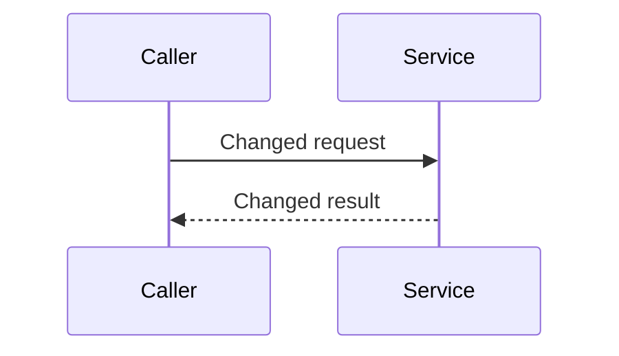

# Pull Request Delivery and CI Checks

Derive `SHIPMATE_PLUGIN_ROOT` from this procedure's installed path (the directory containing
`plugin.json`) before running bundled commands; do not assume a host-provided plugin-root variable.

Read [workflow-policy](../workflow-policy.md) for guided recovery, check classification and
risk-selected review. This procedure does not broaden the calling task's authority.

## Authority

Within an authorized L3 run: push its selected feature branch, create/update its draft pull
request, read pull-request state/logs and perform bounded non-deploy CI repair. Reading an
existing pull request requires no mutation authority. Do not post comments on issues and do not
comment on the pull request unless the user requests it.
When the user wants no pull request, this procedure is skipped entirely: run delivers the
reviewed commit on the feature branch (see run Stage 10) and no forge calls happen.

Human approval required, every time: marking a pull request ready for review, approving,
merging, touching another person's pull request, triggering a deploy workflow, creating tags or
releases, changing CI configuration.

## Preflight

```bash
gh auth status
python3 "${SHIPMATE_PLUGIN_ROOT}/scripts/doctor.py" --group core,delivery
```

`gh` reads `GH_TOKEN` / `GITHUB_TOKEN` from the environment itself. Never extract the token into
a shell variable, never pass it as an argument, and never embed it in a URL — that puts the
credential in shell history and in the agent transcript. Do not `source ~/.zshrc` either; it
emits `compdef` errors under bash.

If a call fails with 401, confirm the credential is present without printing it:

```bash
gh auth status
```

## Pull requests

| Intent | Command |
|--------|---------|
| Push branch | `git push -u origin "$(git rev-parse --abbrev-ref HEAD)"` |
| Open draft pull request | `gh pr create --draft --title "<repository-compliant-title>" --body "<description>"` |
| List | `gh pr list` |
| View | `gh pr view <number>` |
| Diff | `gh pr diff <number>` |
| Update title/body | `gh pr edit <number> --title "<title>" --body "<description>"` |
| Checkout | `gh pr checkout <number>` |

Stop and ask before: `gh pr merge`, `gh pr review --approve`, `gh pr ready`.

The pull-request title is also the default squash commit subject. Obtain the
repository-policy-validated title from `git-commit`; never use `--fill` for an L3 pull request.
GitHub may show a draft title as `Draft: <squash subject>` on the UI; strip only that UI prefix
for validation and never remove it by marking the pull request ready. In repositories that
enforce a work-item-key subject policy, require the canonical subject to match:

```regex
^(feat|fix|docs|style|refactor|perf|test|chore): \[[A-Z]+-[0-9]+\] .+$
```

In Local Markdown mode, never invent a work-item key to satisfy this example. Follow the target
repository's documented title policy and include `work_item.id` when that policy permits it. If
the target repository mandates a work-item key, the missing key is a repository delivery
constraint: stop before push and report it rather than rejecting L3 admission or fabricating an
issue. Any title that violates the actual repository policy blocks handoff even when the branch
CI is green.

## CI checks

```bash
gh pr checks <number>                                 # per-check status, TTY-safe
gh run list --branch "$(git rev-parse --abbrev-ref HEAD)" --limit 5
gh run view <run-id>                                   # job summary, TTY-safe
gh run view --web <run-id>                             # opens browser, non-blocking
```

Read a failing job's log without a browser:

```bash
gh run view <run-id> --log-failed
```

Identify the actual required checks from the repository's branch-protection/configuration, not
from whichever jobs happen to run. Never copy a repository name from the plugin's source
repository when delivering a different target.

## Self-healing failing checks

1. List jobs with `gh pr checks <number>`; identify every failing or pending required check.
2. Read each failing job's log with `gh run view <run-id> --log-failed`; extract the first real
   error, not the final summary line.
3. Reproduce locally with the equivalent command from `repo-context` before changing anything.
4. Classify the repair before acting:
   - no-code infrastructure retry on the same SHA: re-run the check; existing review remains valid;
   - code-changing repair: fix locally, refresh affected verification and obtain current-candidate
     full/delta independent readback under the selected risk roster; do not replay unrelated phases;
   - unavailable local tool: use equivalent required CI only if repository policy permits, with
     verification-pending until the actual check passes;
   - unrelated prerequisite defect: report evidence and propose separately authorized work.
5. For a code-changing repair, push the newly reviewed SHA, record the remote/pull-request SHA and
   pending run in the machine-local review manifest, and update the pull-request description only
   when behavior, rationale, risk, verification, or a known limitation changed.
6. Wait for the actual required checks for that candidate. A skipped or unrelated green check is
   not evidence. When all required checks pass, read the final run SHA and conclusion from
   `gh pr view` / `gh run view` and store them in the machine-local review manifest. Do not copy
   run IDs or internal review identities into the pull-request description.
7. Verify the remote branch SHA, pull-request head SHA, and successful run SHA all match the
   reviewed local `HEAD`.
8. After three failed attempts or repeated no progress, preserve the pull request/worktree and
   report the failed or pending check plus next action. Resume affected work after resolution.

Never disable, skip or force-approve a check to make CI green. That is a control change and needs
a human.

Before L3 handoff, read the pull request back: re-fetch the title, body, head SHA and check
state, and prove current local candidate, remote source branch and pull request match, each
selected independent review covers that same candidate/tree/full diff, and every required check
evaluated it successfully. Keep the risk roster, review scope and exact response/check artifacts
in the machine-local review manifest. An adopted-candidate review must not imply prior
full-lifecycle specification/plan approval.

When a required local check is unavailable, available checks and independent review must pass
before a repository-policy-permitted draft push to obtain equivalent CI evidence. Report
verification-pending until the actual required check passes. A failed required test/security
check or secret hit cannot use this exception. A successful run for an older SHA is stale
evidence, not a green delivery.

## Pull-request description

Write a short `## Description of Change` explaining what changed and why. Read and apply the
bundled sibling [`unslop`](../unslop/PROCEDURE.md) procedure to the final description and
handoff. Include a Mermaid `sequenceDiagram` under that heading whenever the changed interaction
can be shown meaningfully. Use actual participants, calls, and ordering from the current diff;
omit the diagram for changes with no meaningful interaction to show. Use another diagram type
only when it explains the changed behavior more clearly.

Do not add unit-test inventories, numbered TC lists, commands/results, coverage or CI narration,
manual/non-production validation inventories, or `N/A` / `not performed` boilerplate. Omit
`Test Evidence`, `Test Cases`, `Testing Procedure`, `Validation performed`, generic checklists,
and empty `Additional Notes` sections. Do not add `Checklist`, `Risks and limitations`,
deployment or rollback sections, or move their report-style detail under another heading. Omit
approval boxes, compatibility/rollback verdicts, deploy-order narration, unused-field commentary,
unchanged consumer behavior and logging/test gaps. Keep verification evidence in machine-local
artifacts and report meaningful results in the chat handoff. This changes presentation only: all
required checks, independent review and CI verification still apply. If a behavior constraint is
necessary to understand the change, fold it into the short change explanation in one sentence.
Put actionable coordination and verification gaps in the chat handoff. The bundled shape also
applies when a global forge skill or optional repository template offers a longer template; do
not import that boilerplate. Required engineering checks still apply.

Never publish L3 source snapshots, internal hashes, review identities, persona verdict tables,
finding counts, bounded L3 verdicts, or run IDs in the pull-request description or comments. Keep
them in the machine-local review manifest. A work-item or committed-plan link is allowed when
useful. Read the description and diagram back against the final diff. Separately use `gh pr view`
and `gh run view` to verify remote branch, pull-request, and run identities against the manifest.

Before every create/update, read the final description back against the diff and the bundled
unslop shape; fix reported boilerplate before publishing and recheck after any rewrite. This is a
writing check, not a harness interception or a replacement for reading the prose against the
diff. Honor explicitly required target-repository fields, but do not copy optional
test/checklist boilerplate from templates. Do not append the old house template. Default shape:

````markdown
## Description of Change
<short explanation of what changed and why>


````

The participants above are placeholders for the shape only; replace them with verified names
and interactions, or omit the diagram when it would invent a flow. Include extra sections only
when the user explicitly requests them or target-repository policy requires them. Before
publishing, remove excluded sections and report-style detail from agent-written prose; preserve
unrelated human-authored content in an existing pull request.

Never place credentials, customer data, production logs or internal endpoints in a
pull-request description, comment or commit message.

## Release artifacts

For release-artifact lookups, follow the target repository's documented artifact or CI contract,
or record `N/A` when no release artifact applies. Never fall back to an unrelated registry for an
unrelated repository. Reading and reporting results is unattended; acting on them — promoting,
merging, redeploying — is not.

## Failure handling

| Symptom | Action |
|---------|--------|
| `gh` missing | repair the known executable path or use an authorized same-source equivalent; otherwise preserve work and report delivery pending |
| auth failure (`gh auth status` fails / 401) | diagnose selected account/forge access without exposing secrets; never change credentials or bypass denied permission through another client |
| branch not pushed | `git push -u origin "$(git rev-parse --abbrev-ref HEAD)"` |
| merge blocked | report the blocker and stop; do not attempt to clear it |
| required check stuck pending | wait within the run's budget; then preserve the worktree and report the pending check plus next action |
