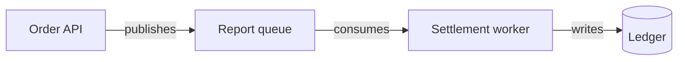
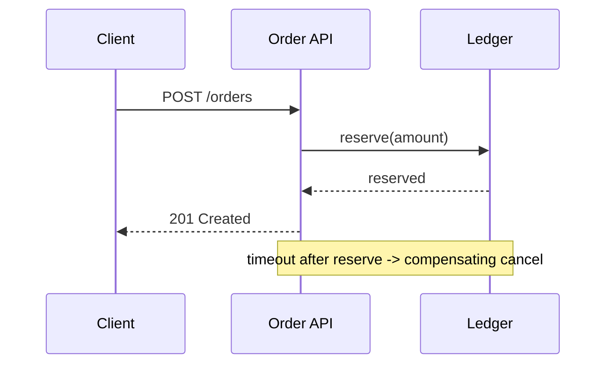

# Draw walkthrough visuals

Used by Walkthrough for boundary maps, interaction diagrams and reader-requested artifacts.
Every visual is evidence: a participant, edge or state the inspected ticket, diff or files do
not support is omitted, not invented. Keep labels terse and put `file:line` or ticket citations
immediately below the diagram, not inside it.

## Pick the medium from the situation

| Situation | Medium |
|---|---|
| Host renders Markdown diagrams (most chat UIs, GitHub web) | Fenced `mermaid` block |
| Plain terminal, quick overview, or a diagram that renders poorly as Mermaid | Fenced `text` block of Unicode box art |
| Diagram too tangled to keep aligned by hand and a renderer is already installed | `termaid`, `mmaid-go` or `plantuml -tutxt` |
| Reader explicitly asks for an artifact | Standalone HTML file (last section) |

Never install, download or build a renderer to serve a walkthrough, and never paste repository
code into a hosted rendering service. If no medium renders well, fall back to a short indented
flow in plain prose.

## Bound every diagram

- One diagram per layer, at most 12 nodes. Split rather than shrink: a second behavior or
  subsystem gets its own diagram at its own checkpoint.
- Keep labels to component, action or field names; values, units and edge cases live in the
  prose below the diagram.
- For component graphs, start with `flowchart LR` and switch to `flowchart TD` once chains grow
  long enough to wrap the reader's viewport or terminal width.
- Never leave a Mermaid diagram syntax-invalid; if unsure of the syntax, simplify the diagram.

## Mermaid patterns

Boundary map for the orientation layer — the components and contracts this change touches:



Interactions for the Interactions layer — one behavior end to end, including its failure path:



never dress a requirement up as implemented behavior.

## Terminal box art

Draw in a fenced `text` block using `┌ ─ │ └ ├ ┤ ▼` and keep every line within 80 columns (120
when the reader confirms a wide terminal). One box per component, one labelled arrow per
contract:

```text
┌─────────────┐  publishes  ┌───────────────────┐  writes  ┌──────────┐
│  Order API  │ ──────────► │ Settlement worker │ ───────► │  Ledger  │
└─────────────┘             └───────────────────┘          └──────────┘
  POST /orders                timeout -> cancel              reserve()
```

Use plain ASCII substitutes (`|`, `-`, `>`) when the reader reports broken box characters. Box
art carries orientation and small flows; deep sequences stay in Mermaid or prose.

## HTML artifact, only on request

Produce the standalone artifact only when the reader explicitly asks for a file or interactive
walkthrough. Write one self-contained `walkthrough-<topic>.html` in the repository root: React,
Tailwind CSS, Mermaid and Shiki loaded from public CDNs; one bounded diagram whose nodes open a
panel with the plain-language explanation, relative file paths and short cited excerpts; pan and
zoom for larger graphs. Everything in the file must trace to inspected evidence, exactly like
the chat layers. The file is the session's only disk write, it never modifies tracked code, and
it supplements rather than replaces the chat explanation. Tell the reader it needs a browser
with network access for the CDN scripts.
